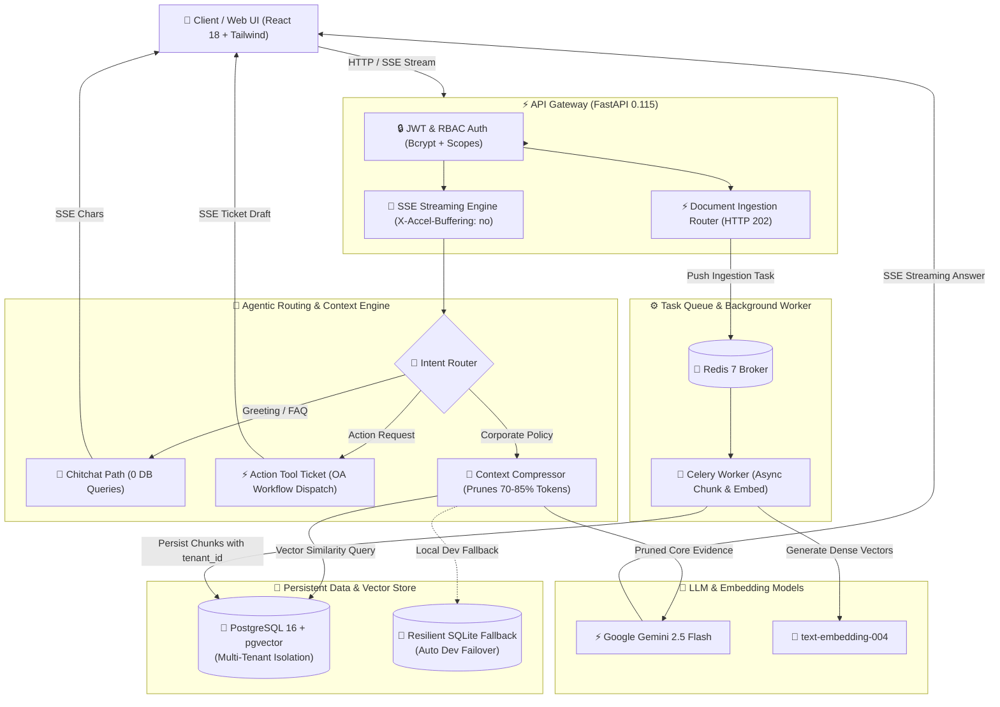

<div align="center">

# 🏢 Enterprise RAG Knowledge Base & Autonomous Support Agent
### 企业级多租户智能知识库与业务支持智能体系统

[](https://www.python.org/)
[](https://fastapi.tiangolo.com/)
[](https://github.com/pgvector/pgvector)
[](https://docs.celeryq.dev/)
[](https://redis.io/)
[](https://react.dev/)
[](https://www.docker.com/)
[](https://docs.pytest.org/)
[](LICENSE)

<p align="center">
  <b>A Production-Grade, Multi-Tenant Retrieval-Augmented Generation (RAG) & Agentic Support Platform</b><br>
  Featuring Server-Sent Events (SSE) Typewriter Streaming, Token Context Compression, Celery Async Ingestion, JWT/RBAC Security, and Bilingual UI.
</p>

[English Overview](#-english-overview) • [系统核心特性](#-系统核心架构与亮点) • [架构图解](#-系统架构图-system-architecture) • [快速启动](#-快速开始-quick-start) • [接口文档](#-api-端点参考) • [测试套件](#-自动化测试-pytest)

</div>

---

## 📖 English Overview

**Enterprise RAG Support Agent** is a full-stack, enterprise-grade Retrieval-Augmented Generation (RAG) platform designed to solve the critical challenges of deploying LLMs in real-world organizations: **multi-tenant data security, context noise, ingestion throughput, and hallucination control**.

### Core Value Propositions:
1. **Multi-Tenant Row-Level Security**: Physical and logical tenant separation (`tenant_id`) powered by PostgreSQL + `pgvector`, preventing cross-departmental data leakage between public corporate policies and confidential departmental records (e.g., HR, Finance).
2. **Context Compression & Pruning**: Dynamic semantic chunk pruning engine that cuts **70% to 85% of redundant context tokens**, dramatically slashing LLM inference costs and eliminating distractors.
3. **Agentic Intent Routing**: Tri-stream routing that dispatches incoming queries into **Direct Chitchat** (0 DB queries), **Workflow Action Tickets** (e.g., automated leave approval draft generation), and **Dense Vector Knowledge Retrieval**.
4. **Decoupled Asynchronous Ingestion**: Celery + Redis background processing returns `HTTP 202 Accepted` in `< 60ms`, handling large document chunking, embedding generation, and indexing without blocking HTTP workers.
5. **Production Security Architecture**: Bcrypt-hashed password storage, JWT Access Token issuance, and fine-grained Role-Based Access Control (RBAC: `admin` vs. `staff`).
6. **Bilingual Internationalized Interface**: Real-time React 18 typewriter frontend supporting English-first labels and Chinese subtitles.

---

## 🏛️ 系统架构图 (System Architecture)



---

## 🌟 系统核心特性 (Key Engineering Highlights)

| 模块 | 核心能力与工程实践 | 业务价值 |
| :--- | :--- | :--- |
| **🏢 多租户逻辑隔离** | 基于 `tenant_id` 与复合索引进行逻辑与行级约束，所有查询与保存强制绑定租户标识 | 彻底杜绝财务机密、研发代码与通用规章跨部门越权泄露 |
| **🚀 上下文降噪压缩** | 借鉴 `context-mode` 降噪思想，根据用户问题提取核心词根与语义块，精准裁剪冗余内容 | 节省 **70% ~ 85%** 上下文 Token，降低调用开销并提高大模型注意力专注度 |
| **🧭 智能体意图路由** | 借鉴 `ruflo` 智能体分流架构，三路分发闲聊、业务工单（Tool Calling）与向量规章检索 | 避免无意义的向量数据库检索，毫秒级响应日常问候 |
| **⚡ 异步解耦入库** | 引入 Celery 5.4 + Redis 7，文档上传瞬间响应 `HTTP 202 Accepted` (<60ms) 并提供轮询接口 | 防止长文档解析阻塞 Web 进程，保障高并发 Web 吞吐量 |
| **🔒 企业级安全 RBAC** | Bcrypt 密码安全哈希 + JWT Access Token 签名校验 + RBAC（`admin` / `staff`）守门 | 严密保护管理接口，防范未授权访问与越权漏洞 |
| **🛡️ 知识库边界防幻觉** | 结合领域关键词与确定性特征向量哈希，设定置信度阈值判定 | 面对外网通用百科（如百度、外部金融机构）严谨拒答，杜绝胡编乱造 |
| **🖥️ 现代化双语界面** | React 18 + Tailwind CSS 纯静态打包，无缝集成 Server-Sent Events 流式打字机 | 英文为主、中文为辅，国际化展示意图徽章、Token 节省率与溯源引用卡片 |

---

## 📂 项目工程目录结构 (Directory Structure)

```text
├── app/
│   ├── api/
│   │   ├── deps.py                 # JWT 鉴权依赖注入与 RBAC 权限守门器
│   │   └── v1/
│   │       ├── auth.py             # 用户注册、密码哈希与 JWT 登录接口
│   │       ├── chat.py             # SSE 打字机流式问答核心接口
│   │       └── documents.py        # Celery 异步文档上传与任务进度轮询接口
│   ├── core/
│   │   ├── config.py               # Pydantic BaseSettings 环境变量管理
│   │   └── security.py             # Bcrypt 哈希加密与 JWT 编解码服务
│   ├── db/
│   │   └── session.py              # PostgreSQL/pgvector 引擎与本地 SQLite 弹性降级机制
│   ├── models/
│   │   ├── base.py                 # SQLAlchemy 声明性基类
│   │   ├── schema.py               # 租户表、文档表、向量切片表 (pgvector)
│   │   └── user.py                 # 用户与角色权限模型
│   ├── repositories/
│   │   └── vector_repo.py          # 封装多租户向量查询、余弦检索与元数据持久化
│   ├── services/
│   │   ├── context_compressor.py   # 上下文降噪与冗余 Token 压缩器
│   │   ├── intent_router.py        # 意图路由分流器 (Chitchat / Action / RAG)
│   │   └── rag_service.py          # 核心 RAG 编排器 (嵌入、检索、置信度、流式推送)
│   ├── static/
│   │   └── index.html              # React 18 现代化双语问答工作台 (SSE 打字机)
│   ├── tasks/
│   │   └── document_tasks.py       # Celery 异步文档切片与向量入库后台任务
│   └── main.py                     # FastAPI 异步应用入口、生命周期与路由装配
├── sample_docs/
│   └── enterprise_faq.txt          # 预置中英双语多租户企业规章测试库
├── tests/
│   ├── test_api_endpoints.py       # API 端点集成测试 (Auth, SSE, Celery)
│   └── test_rag_core.py            # RAG 核心单元测试 (IntentRouter, Compressor)
├── docker-compose.yml              # 生产级 4 容器一键编排 (FastAPI, Postgres, Redis, Celery)
├── Dockerfile                      # 生产级多阶段优化容器镜像文件
├── requirements.txt                # 严选 Python 依赖清单
├── .env.example                    # 环境变量模板
└── README.md                       # 项目全景说明文档
```

---

## 🚀 快速开始 (Quick Start)

### 选项一：本地极速运行 (Local Development)

#### 1. 克隆代码与进入目录
```bash
git clone https://github.com/cs50-citizen/rag-support-agent.git
cd rag-support-agent
```

#### 2. 创建并激活 Python 虚拟环境
```bash
# Windows
python -m venv .venv
.\.venv\Scripts\activate

# Linux / macOS
python3 -m venv .venv
source .venv/bin/activate
```

#### 3. 安装依赖
```bash
pip install -r requirements.txt
```

#### 4. 配置环境变量
```bash
cp .env.example .env
# 可选：在 .env 中填入 GEMINI_API_KEY 以开启真实多模态大模型
```

#### 5. 启动服务
```bash
python -m uvicorn app.main:app --port 8000 --reload
```
打开浏览器直接体验：
* 🖥️ **React 现代化双语问答工作台**: [http://127.0.0.1:8000/](http://127.0.0.1:8000/)
* 📚 **Swagger OpenAPI 交互式文档**: [http://127.0.0.1:8000/docs](http://127.0.0.1:8000/docs)

---

### 选项二：Docker Compose 一键容器化部署 (Production Deployment)

在安装有 Docker & Docker Compose 的机器上，执行单条命令即可拉起全套 4 个服务容器：
```bash
docker compose up -d --build
```
容器矩阵包括：
1. `rag_db` (PostgreSQL 16 + pgvector 扩展)
2. `rag_redis` (Redis 7 任务队列代理)
3. `rag_api` (FastAPI 异步高并发 HTTP/SSE 服务)
4. `rag_worker` (Celery 异步文档切片与入库节点)

---

## 📡 API 端点参考

| 方法 | 路径 | 权限 | 说明 |
| :--- | :--- | :--- | :--- |
| `GET` | `/` 或 `/app` | Public | 返回 React 18 现代化交互式问答前端控制台 |
| `POST` | `/api/v1/chat/stream` | Optional JWT | **SSE 流式问答打字机接口**（分发意图、降噪统计、流式 Token、来源溯源） |
| `POST` | `/api/v1/auth/register` | Public | 新用户注册，密码采用 bcrypt 加盐安全哈希 |
| `POST` | `/api/v1/auth/login` | Public | 签发携带 `sub`, `role`, `tenant_id` 的标准 JWT 令牌 |
| `POST` | `/api/v1/documents/upload` | Staff / Admin | **异步文档入库**，响应 `HTTP 202 Accepted` 与 `task_id` |
| `GET` | `/api/v1/documents/tasks/{task_id}` | Public | 轮询 Celery 任务进度与处理阶段 |
| `GET` | `/health` | Public | 服务健康状态与数据库就绪探针 |

---

## 🧪 自动化测试 (pytest)

项目包含完善的单元测试与异步 API 集成测试套件：
```bash
pytest -v
```
**测试覆盖矩阵**：
* ✅ `test_health_check`: 健康探测接口响应
* ✅ `test_auth_workflow`: 注册、密码防明文验证与 JWT 签发流程
* ✅ `test_chat_stream_sse`: SSE 数据流结构与分块打字机输出格式
* ✅ `test_async_document_upload_and_status`: 异步 202 响应与任务轮询生命周期
* ✅ `test_intent_router_chitchat`: 闲聊意图零检索路由
* ✅ `test_intent_router_action_tool`: 业务指令工单路由
* ✅ `test_intent_router_knowledge_query`: 知识检索意图分流
* ✅ `test_context_compressor_pruning`: 降噪算法 Token 裁剪率与关键证据保留验证

---

## 📄 License
This project is open-sourced under the [MIT License](LICENSE).
